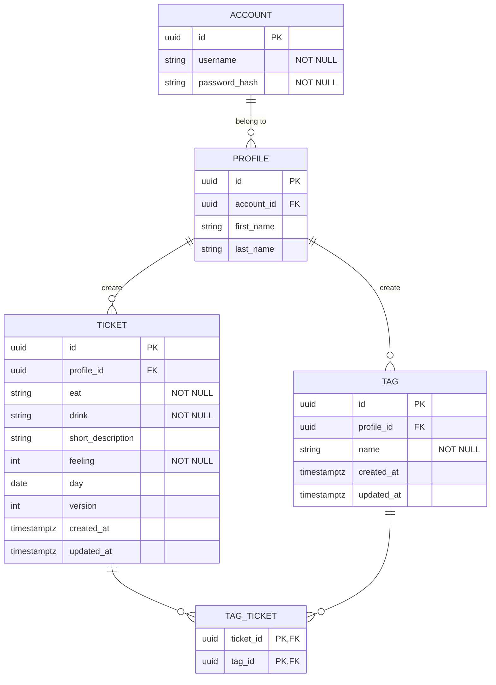

``` Chốt quan hệ:
  Account 1:N Profile
  Profile 1:N Ticket
  Profile 1:N Tag
  Ticket N:N Tag

  Technique: spring-boot (java), nextjs
  Database: PostgreSQL
  Environment: Docker, CLI
```

### Constraints
- ACCOUNT: `UNIQUE (username)`
- TICKET: `UNIQUE (day, profile_id)`
- TAG: `UNIQUE (profile_id, name)`



### Notes
- Done: đã tạm xong phần data-mode, thiết kế ERD (done data-model, design ERD)
- Learned: cách viết mermaid (how to create ERD in mermaid)
- Stuck: lẫn lộn giữa postgreSQL và java trong datatype, không biết cú pháp mermaid (mix datatype between postgreSQL and Java, don't know syntax mermaid, so this is a main reason speed a lot of time in day 0)
- Next: create backend + tạo docker + tạo V0 đầu tiên cho database (create BE spring-boot (/src), int docker, create V0 for db)

--- Fix notes:
- Done: Finished the data model and drew the ERD.
- Learned: How to write an ERD in Mermaid.
- Stuck: I mixed up PostgreSQL and Java data types, and I didn't know the Mermaid syntax. That's why Day 0 took so long.
- Next: Create the Spring Boot backend, set up Docker, and create the first database migration.