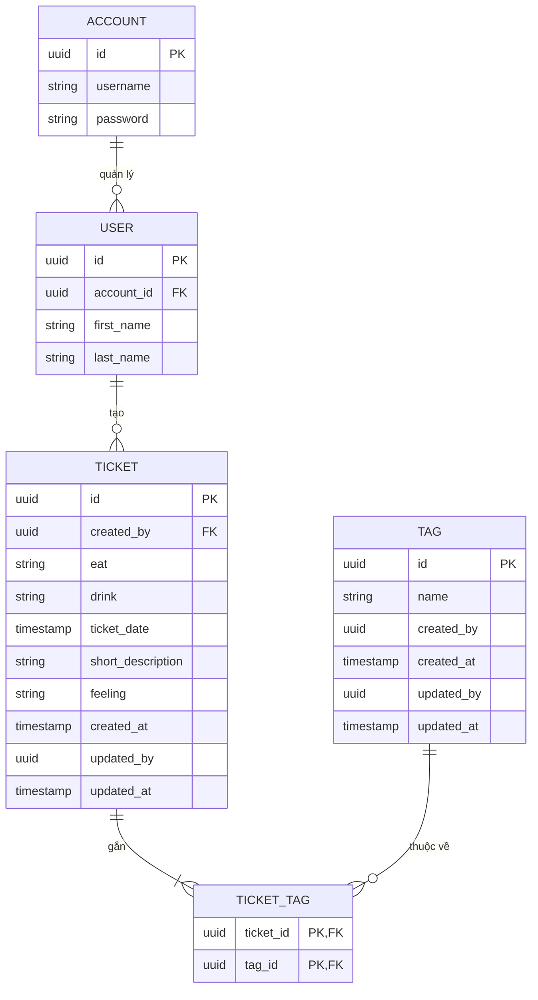

# Ghi chú Thiết kế Database & Ký hiệu Mermaid ERD

Tài liệu tổng hợp các quy tắc thiết kế quan hệ cơ sở dữ liệu (PostgreSQL) và cách biểu diễn bằng sơ đồ `erDiagram` trong Mermaid.

---

## 1. Cấu trúc đường nối quan hệ

Một đường nối trong Mermaid ERD gồm **2 đầu**, thể hiện chiều đọc từ **Bảng A sang Bảng B**:

```text
BẢNG_A [Đầu_trái]--[Đầu_phải] BẢNG_B : "Mô tả mối quan hệ"
```

Mỗi đầu gồm **2 ký tự**:
* **Ký tự gần bảng hơn:** Biểu thị tính bắt buộc (`|` là bắt buộc, `o` là tùy chọn/không bắt buộc).
* **Ký tự ngoài cùng:** Biểu thị số lượng (`|` là 1, `{` hoặc `}` là nhiều).

---

## 2. Bảng tra cứu ký hiệu

| Ký hiệu (Trái / Phải) | Tên gọi | Ý nghĩa thực tế | Ví dụ áp dụng |
| :--- | :--- | :--- | :--- |
| `\|\|` | **Bắt buộc đúng 1** | Phải có và chỉ tồn tại duy nhất 1 bản ghi. | Một User bắt buộc thuộc về duy nhất 1 Account. |
| `\|o` hoặc `o\|` | **0 hoặc 1** | Có thể không có, hoặc nếu có thì chỉ có đúng 1. | Một User có thể có 0 hoặc 1 hồ sơ mở rộng. |
| `}\|` hoặc `\|{` | **1 hoặc nhiều** | Phải có ít nhất 1 bản ghi trở lên (không được trống). | Một Ticket bắt buộc phải có ít nhất 1 Tag. |
| `}o` hoặc `o{` | **0 hoặc nhiều** | Có thể không có bản ghi nào, hoặc có nhiều tùy ý. | Một Account có thể quản lý 0 hoặc nhiều User. |

---

## 3. Quy tắc đặt Khóa ngoại (Foreign Key)

1. **Quan hệ 1 - 1 (`||--||` hoặc `||--o|`):**
   * Đặt khóa ngoại (kèm ràng buộc `UNIQUE`) ở bảng phụ thuộc.
2. **Quan hệ 1 - Nhiều (`||--o{`):**
   * **Luôn đặt khóa ngoại ở phía bảng "Nhiều"**.
   * *Ví dụ:* `ACCOUNT ||--o{ USER` $\rightarrow$ Cột `account_id` nằm trong bảng `USER` (mỗi dòng lưu 1 UUID đơn, không lưu dạng list).
3. **Quan hệ Nhiều - Nhiều (`}o--o{`):**
   * **Bắt buộc tạo bảng trung gian** ở giữa để tách thành hai quan hệ `1 - Nhiều`.
   * Bảng trung gian chứa 2 khóa ngoại của hai bảng chính gộp lại làm **Khóa chính kép (Composite Primary Key)** để chống trùng lặp dữ liệu.

---

## 4. Mẫu sơ đồ hoàn chỉnh áp dụng cho dự án

