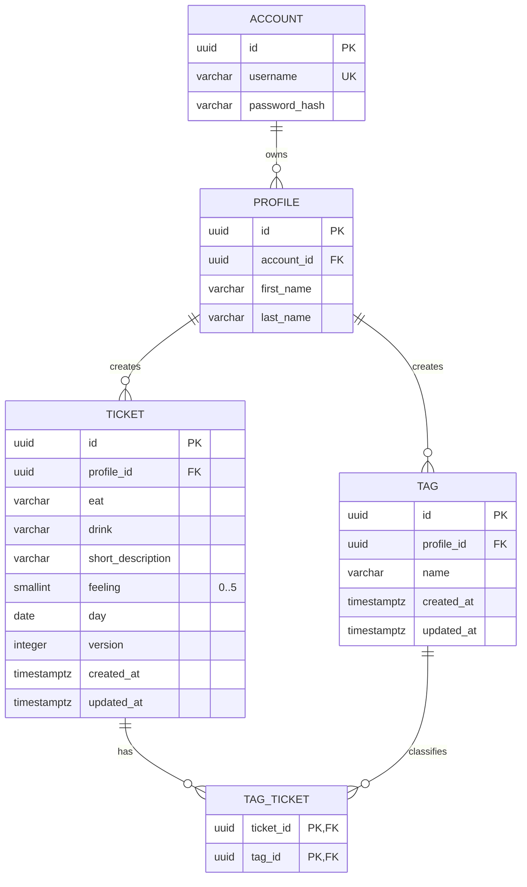

# Thiết kế dữ liệu và ERD

Dùng cho: Ngày 0 (thiết kế dữ liệu, `docs/notes/data-model.md`).

Tổng hợp luật thiết kế quan hệ cho PostgreSQL và cách vẽ bằng `erDiagram` của Mermaid.

## 1. Bảng, dòng, cột

- **Bảng (table)**: một loại thứ cần lưu.
- **Dòng (row)**: một thứ cụ thể.
- **Cột (column)**: một thông tin của thứ đó. Mỗi cột có đúng một kiểu dữ liệu.

## 2. Một ô chỉ chứa một giá trị (atomic value)

Luật gốc của thiết kế quan hệ. Không lưu list trong một ô.

- **1-N**: FK nằm ở bảng bên N. Bảng bên 1 không có cột nào trỏ sang bảng bên N.
- **N-N**: tách ra bảng trung gian. Hai bảng chính không có cột nào trỏ sang nhau.
- **1-1**: FK nằm ở bảng phụ thuộc, kèm `UNIQUE`.

Quy tắc đặt khoá ngoại (Foreign Key) cho từng loại quan hệ:

1. **1-1** (`||--||` hoặc `||--o|`): đặt FK (kèm `UNIQUE`) ở bảng phụ thuộc.
2. **1-N** (`||--o{`): **luôn đặt FK ở phía bảng "nhiều"**. Ví dụ `ACCOUNT ||--o{ PROFILE` thì cột `account_id` nằm trong bảng `PROFILE`. Mỗi dòng lưu một UUID đơn, không lưu dạng list.
3. **N-N** (`}o--o{`): **bắt buộc tạo bảng trung gian** để tách thành hai quan hệ 1-N. Bảng trung gian chứa hai FK của hai bảng chính, gộp lại làm **khoá chính kép (composite primary key)** để chống trùng.

## 3. Kiểu dữ liệu

ERD vẽ cho database thì dùng kiểu **PostgreSQL**. Kiểu **Java** chỉ xuất hiện ở Entity.

| PostgreSQL | Java (Entity) | Dùng cho |
| --- | --- | --- |
| `uuid` | `UUID` | Khoá chính, khoá ngoại |
| `text` | `String` | Chữ, không giới hạn độ dài |
| `varchar(n)` | `String` | Chữ có giới hạn độ dài |
| `smallint` | `Short` | Số nhỏ (-32768 tới 32767) |
| `integer` | `Integer` / `int` | Số nguyên |
| `bigint` | `Long` / `long` | Số nguyên lớn |
| `boolean` | `Boolean` / `boolean` | Đúng / sai |
| `date` | `LocalDate` | Ngày, không có giờ |
| `timestamptz` | `Instant` / `OffsetDateTime` | Thời điểm, có múi giờ |
| `timestamp` | `LocalDateTime` | Thời điểm, **không** có múi giờ. Sổ Sói không dùng. |

- Kiểu wrapper (`Integer`, `Short`) nhận được `null`. Kiểu primitive (`int`, `short`) thì không. Cột cho phép `NULL` thì dùng wrapper.
- `@Version` dùng `Long` / `long` hoặc `Integer` / `int`.
- FK không phải là kiểu dữ liệu. FK là một cột kiểu `uuid` có gắn thêm ràng buộc `FOREIGN KEY`.

### Quyết định cho `feeling` (chốt 2026-11-25)

`feeling` là **số từ 0 đến 5**, không phải chữ. Ví dụ cột `smallint` kèm `CHECK (feeling BETWEEN 0 AND 5)`. Ngày 4, 6, 9 cần so sánh và tính trung bình nên phải là số. (Sơ đồ ở `docs/notes/data-model.md` còn ghi `string`/`int`, cần khớp lại khi làm Ngày 2.)

## 4. Ràng buộc (constraint)

Luật do database tự kiểm, code không lách qua được.

| Ràng buộc | Ý nghĩa |
| --- | --- |
| `NOT NULL` | Không được bỏ trống |
| `UNIQUE` | Không được trùng. Áp cho một cột, hoặc cho một tổ hợp cột (`UNIQUE (a, b)`): chỉ cặp giá trị không được trùng, từng cột riêng lẻ thì trùng được |
| `PRIMARY KEY` | `UNIQUE` + `NOT NULL`, dùng để xác định một dòng. Một bảng chỉ có một PK; PK có thể gồm nhiều cột (composite key) |
| `FOREIGN KEY` | Giá trị phải tồn tại ở bảng được tham chiếu |
| `CHECK` | Giá trị phải thoả một điều kiện |

Mermaid `erDiagram` chỉ đánh dấu được `PK`, `FK`, `UK` trên từng cột. Unique theo tổ hợp cột thì ghi bằng chữ dưới sơ đồ.

## 5. Mỗi cột một nghĩa

Hai cột cùng lưu một thông tin thì sớm muộn sẽ lệch nhau. Mỗi thông tin chỉ lưu ở một chỗ.

## 6. Mermaid `erDiagram`

- Thuộc tính viết theo thứ tự `kiểu tên [PK|FK|UK] ["ghi chú"]`.
- Tên cột trong PostgreSQL dùng `snake_case`.
- Đường nối viết liền, không có dấu cách. Mẫu: `BẢNG_A [đầu_trái]--[đầu_phải] BẢNG_B : "mô tả"`, đọc từ bảng A sang bảng B.
- Mỗi đầu nối có hai ký tự. Ký tự **sát bảng** là số lượng tối đa (`|` một, `{` `}` nhiều). Ký tự **phía đường nối** là số lượng tối thiểu (`o` không, `|` một).

| Ký hiệu | Tên | Nghĩa | Ví dụ |
| --- | --- | --- | --- |
| `\|\|` | Đúng một | Phải có và chỉ có một bản ghi | Một Profile bắt buộc thuộc về đúng một Account |
| `\|o` / `o\|` | Không hoặc một | Có thể không có, nếu có thì chỉ một | Một Account có 0 hoặc 1 hồ sơ mở rộng |
| `\|{` / `}\|` | Một hoặc nhiều | Phải có ít nhất một | Một Ticket bắt buộc có ít nhất một Tag |
| `o{` / `}o` | Không hoặc nhiều | Có thể không có, hoặc nhiều tuỳ ý | Một Account có 0 hoặc nhiều Profile |

### Mẫu sơ đồ cho Sổ Sói

Unique theo tổ hợp (Mermaid không vẽ được): `TICKET UNIQUE (profile_id, day)`, `TAG UNIQUE (profile_id, name)`; `ACCOUNT.username` là `UNIQUE` một cột. Sơ đồ chính thức của anh nằm ở `docs/notes/data-model.md`; mẫu trên chỉ để tra ký hiệu.

Docs: [Mermaid: Entity Relationship Diagrams](https://mermaid.js.org/syntax/entityRelationshipDiagram.html) · [PostgreSQL: Constraints](https://www.postgresql.org/docs/current/ddl-constraints.html).
