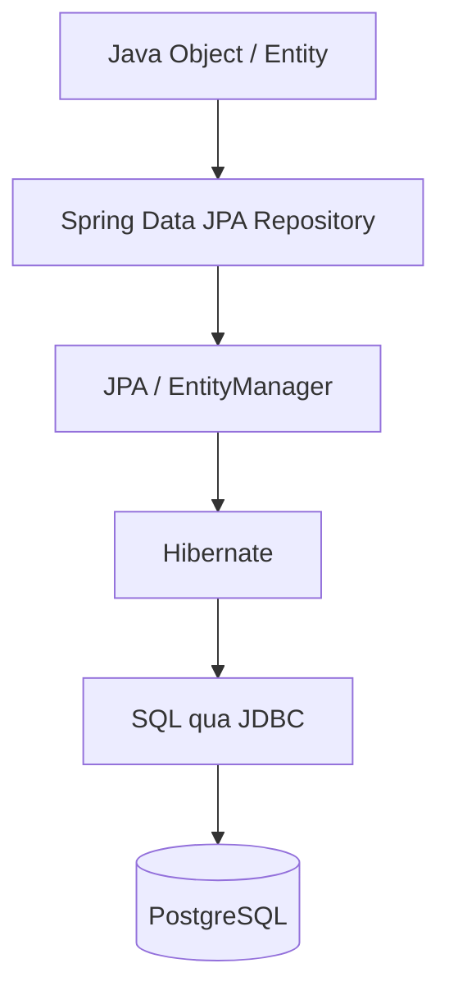
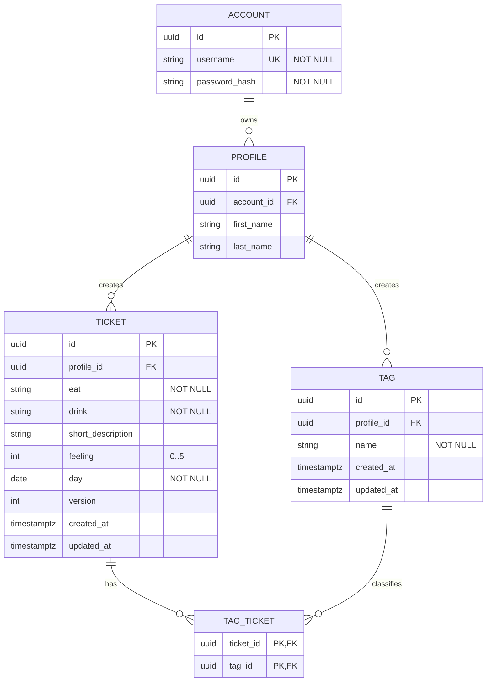
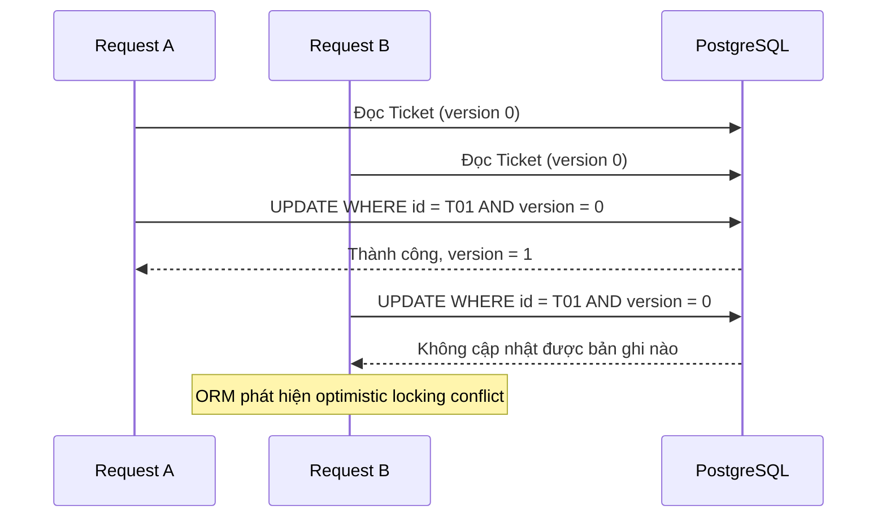
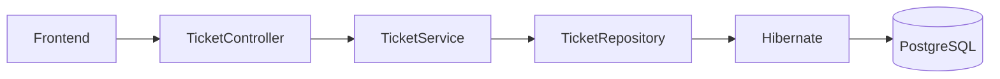

# JPA, Entity, Repository và persistence

Dùng cho: Ngày 2 (Entity, Repository), Ngày 5 (unique, `@Version`).

> Đánh số mục giữ theo bài gốc nên có chỗ nhảy số: mục 3 (Lombok, Maven) nằm ở `01-spring-boot-basics.md`, mục 9 (code mẫu) nằm ở phụ lục cuối file.

## Tóm tắt khái niệm

**JPA** là cách làm việc với database bằng object Java thay vì viết SQL bằng tay. **Hibernate** là thư viện thực hiện JPA phía dưới.

- **Entity** (`@Entity`) = một class Java tương ứng với một bảng. Mỗi object là một dòng, mỗi field là một cột. Ví dụ `Ticket` là bảng `ticket`.
- `@Id` đánh dấu khoá chính, `@GeneratedValue` để sinh id. Sổ Sói dùng UUID.
- Entity cần một constructor rỗng, vì JPA dùng nó để tạo object khi đọc dữ liệu ra.
- **Repository**: chỉ khai báo interface `extends JpaRepository<Ticket, UUID>`. Spring **tự sinh code** cho `save`, `findById`, `findAll`, `deleteById`.
- **Query method**: đặt tên hàm theo quy tắc, ví dụ `findByProfileId(...)`, Spring tự hiểu và tạo câu SQL.
- Chạy Postgres bằng Docker giúp không phải cài database vào máy. Ba biến quan trọng: `POSTGRES_USER`, `POSTGRES_PASSWORD`, `POSTGRES_DB`.

Ví dụ nhanh bằng `docker run` (Sổ Sói dùng `docker compose` có volume, xem Ngày 1 trong roadmap):

```bash
docker run -d --name sosoi-db -p 5432:5432 -e POSTGRES_USER=dev -e POSTGRES_PASSWORD=dev -e POSTGRES_DB=sosoi postgres:16
```

## 0. Mục tiêu và phạm vi

Ngày 2 tập trung vào cách biểu diễn dữ liệu bằng Java Entity, lưu dữ liệu bằng Repository và đảm bảo tính toàn vẹn của database.

- [ ] Tạo Entity `Account`, `Profile`, `Ticket` và Repository tương ứng.
- [ ] Ánh xạ `Profile → Account` và `Ticket → Profile` bằng `@ManyToOne`.
- [ ] Tự động gán `created_at`, `updated_at` cho `Ticket`.
- [ ] Đảm bảo `username` không trùng lặp.
- [ ] Đảm bảo mỗi Profile chỉ có một Ticket trong một ngày.
- [ ] Dùng `@Version` để phát hiện xung đột khi cập nhật hoặc xóa cùng bản ghi.
- [ ] Kiểm tra các bảng, khóa và dữ liệu thực tế trong PostgreSQL.

**Ví dụ xuyên suốt — Sosoi:** một ứng dụng nhật ký hằng ngày. Người dùng sở hữu Account, có thể tạo nhiều Profile; mỗi Profile ghi lại việc ăn, uống, cảm xúc và mô tả ngắn cho từng ngày. Sau này có thêm Tag để phân loại nhật ký.

**Quy ước của ví dụ:** mỗi Profile có tối đa một Ticket mỗi ngày; `feeling` từ 0 đến 5; `eat` và `drink` không để trống. Quy tắc cảm xúc dựa trên code đang học; quy tắc không cho chuỗi trắng chặt hơn `NOT NULL` trong ERD ban đầu. `Account` và `Profile` chưa có timestamp theo ERD. `Tag` và `TagTicket` nằm ngoài phạm vi triển khai Ngày 2. Code dưới đây là mẫu tham khảo, chưa được chạy trên project/database thực tế.

## 1. Hiểu luồng Persistence



| Thành phần | Vai trò |
|---|---|
| Java Object | Đối tượng chứa dữ liệu trong bộ nhớ. |
| Entity | Java Object được JPA ánh xạ đến dữ liệu quan hệ. |
| Repository | Cung cấp các thao tác lưu, đọc, xóa và truy vấn dữ liệu. |
| JPA (Jakarta Persistence) | Bộ đặc tả/API quy định cách quản lý Entity và ORM. |
| Hibernate | Triển khai JPA, quản lý Entity và tạo SQL. |
| JDBC | API để Java kết nối và gửi SQL qua driver database. |
| SQL | Ngôn ngữ giao tiếp với database. |
| PostgreSQL | Hệ quản trị database, thực thi SQL và lưu dữ liệu. |
| Spring Boot | Tích hợp và tự cấu hình các thành phần của ứng dụng. |

Ví dụ: gọi `ticketRepository.save(ticket)` → Hibernate quản lý Entity → khi flush, Hibernate phát sinh SQL phù hợp → PostgreSQL thực thi. Không phải cứ gọi `save()` là SQL luôn chạy ngay tại dòng đó; việc flush/commit còn phụ thuộc transaction.

**Keywords:** ORM (Object-Relational Mapping), Persistence Layer, JPA, Hibernate, JDBC, CRUD.

## 2. Tổ chức folder

### Package by Layer — phù hợp để học hiện tại

```text
src/
├── main/
│   ├── java/com/example/sosoi/
│   │   ├── SosoiApplication.java
│   │   ├── entity/
│   │   │   ├── Account.java
│   │   │   ├── Profile.java
│   │   │   └── Ticket.java
│   │   └── repository/
│   │       ├── AccountRepository.java
│   │       ├── ProfileRepository.java
│   │       └── TicketRepository.java
│   └── resources/
│       └── application.properties
└── test/
    └── java/com/example/sosoi/
```

Khi sang các ngày tiếp theo, bổ sung `service/`, `controller/`, `dto/`, `mapper/`, `exception/` hoặc `config/` khi có nhu cầu. Có thể tạo `common/entity/` nếu thực sự cần `BaseEntity`.

| Folder | Trách nhiệm |
|---|---|
| entity | Ánh xạ dữ liệu và quan hệ database. |
| repository | Truy cập và truy vấn dữ liệu. |
| service | Xử lý nghiệp vụ, transaction. |
| controller | Nhận request và trả response HTTP. |
| dto | Dữ liệu trao đổi với client. |
| mapper | Chuyển đổi giữa Entity và DTO. |

### Package by Feature — khi dự án tăng số lượng nghiệp vụ

```text
com/example/sosoi/
├── SosoiApplication.java
├── account/
│   ├── Account.java
│   └── AccountRepository.java
├── profile/
│   ├── Profile.java
│   └── ProfileRepository.java
└── ticket/
    ├── Ticket.java
    └── TicketRepository.java
```

Package by Layer nhóm theo trách nhiệm kỹ thuật; Package by Feature nhóm theo nghiệp vụ. Spring Boot không bắt buộc một cấu trúc cố định. Nên đặt main class có `@SpringBootApplication` ở package gốc, bên trên các Entity và Repository để thuận tiện cho việc tự động scan.

Docs: [Spring Boot — Structuring Your Code](https://docs.spring.io/spring-boot/reference/using/structuring-your-code.html).

## 4. ERD và quan hệ Entity

ERD tổng thể (gồm phần mở rộng sau Ngày 2):



`Ticket` có thêm quy tắc `UNIQUE(profile_id, day)`; Mermaid ở trên không biểu diễn riêng ràng buộc tổ hợp đó.

| Quan hệ | Ý nghĩa | Bên giữ FK |
|---|---|---|
| Account 1:N Profile | Một Account có nhiều Profile; mỗi Profile thuộc một Account. | Profile (`account_id`) |
| Profile 1:N Ticket | Một Profile có nhiều Ticket; mỗi Ticket thuộc một Profile. | Ticket (`profile_id`) |
| Profile 1:N Tag | Một Profile có thể tạo nhiều Tag. | Tag (`profile_id`) |
| Tag N:M Ticket | Một Tag có thể được gắn vào nhiều Ticket và ngược lại. | Bảng trung gian `tag_ticket` (học sau). |

### Tại sao bên nhiều khai báo @ManyToOne?

Trong quan hệ 1:N này, mỗi bản ghi bên N lưu ID của bản ghi bên 1. Nhiều Profile có thể cùng trỏ đến một Account.

```java
@ManyToOne(optional = false, fetch = FetchType.LAZY)
@JoinColumn(name = "account_id", nullable = false)
private Account account;
```

- `@ManyToOne`: Khai báo nhiều Profile tham chiếu một Account.
- `optional = false`: Quan hệ bắt buộc trong mô hình Entity.
- `@JoinColumn`: Xác định cột FK.
- `nullable = false`: Khai báo FK bắt buộc ở schema.
- `fetch = FetchType.LAZY`: Gợi ý chỉ tải Account khi cần; tránh lấy dữ liệu liên quan không cần thiết. Mặc định ManyToOne là EAGER và LAZY là hint theo JPA.
- `referencedColumnName = "id"`: Có thể bỏ, mặc định tham chiếu PK của Entity đích.

Trong Java dùng `Account account`, không nhất thiết phải khai báo thêm `UUID accountId`. Hibernate ánh xạ đối tượng sang khóa ngoại `account_id`.

### Quan hệ một chiều và hai chiều

```text
Một chiều:  Profile ──ManyToOne──> Account
Hai chiều:  Profile <────────────> Account
```

Nếu chỉ cần truy cập Account từ Profile, quan hệ một chiều là đủ. Nếu cần duyệt danh sách Profile từ Account, có thể khai báo thêm ở Account:

```java
@OneToMany(mappedBy = "account")
private List<Profile> profiles = new ArrayList<>();
```

`mappedBy` trỏ tới tên field Java `account` trong Profile, không phải tên cột `account_id`. Đây là phía nghịch đảo; Profile vẫn quản lý FK. Với quan hệ hai chiều cần giữ hai phía đồng bộ trong bộ nhớ. Ngày 2 chưa cần thêm chiều ngược.

Docs: [ManyToOne](https://jakarta.ee/specifications/persistence/3.2/apidocs/jakarta.persistence/jakarta/persistence/ManyToOne.html) · [Jakarta Persistence](https://jakarta.ee/specifications/persistence/3.2/jakarta-persistence-spec-3.2.html).

## 5. Validation và Database Constraints

**Bean Validation** kiểm tra dữ liệu của Java Object. **Database Constraint** bảo vệ dữ liệu đã hoặc sẽ lưu vào database, kể cả khi có nhiều request cùng lúc.

Project đã có `spring-boot-starter-validation`, vì vậy chưa cần thêm thư viện validation.

### Jakarta Validation

Các annotation thuộc `jakarta.validation.constraints`.

| Annotation | Ý nghĩa |
|---|---|
| `@NotNull` | Không được null. Chuỗi rỗng vẫn hợp lệ. |
| `@NotEmpty` | Không được null hoặc rỗng. Chuỗi chỉ có khoảng trắng vẫn có thể hợp lệ. |
| `@NotBlank` | Không được null, rỗng hoặc chỉ chứa khoảng trắng. |
| `@Size(min = 3, max = 50)` | Giới hạn độ dài/kích thước (null cần ràng buộc riêng). |
| `@Min(0)` / `@Max(5)` | Giới hạn giá trị số (null cần ràng buộc riêng). |
| `@Pattern` | Kiểm tra định dạng bằng regex. |
| `@Email` | Kiểm tra định dạng email. |

Không cần thêm `@NotNull` khi đã dùng `@NotBlank` cho cùng một chuỗi.

### Jakarta Persistence

| Annotation | Ý nghĩa |
|---|---|
| `@Column(nullable = false)` | Khai báo cột NOT NULL. |
| `@Column(unique = true)` | Khai báo UNIQUE trên một cột. |
| `@Column(length = 50)` | Khai báo độ dài cột chuỗi khi tạo schema. |
| `@UniqueConstraint` | Khai báo UNIQUE trên một hoặc nhiều cột. |
| `@JoinColumn(nullable = false)` | Khai báo cột FK không null. |

Ví dụ username không trùng, không rỗng:

```java
@NotBlank
@Column(nullable = false, unique = true)
private String username;
```

Sau này có thể kiểm tra trước ở Service qua `existsByUsername(...)` để trả lỗi thân thiện. Tuy nhiên, hai request có thể cùng vượt qua bước kiểm tra; UNIQUE ở PostgreSQL vẫn là lớp bảo vệ cuối cùng. Nếu muốn username không phân biệt hoa/thường, cần thêm quy tắc chuẩn hóa hoặc constraint/index phù hợp (UNIQUE chuỗi thông thường không tự làm điều đó).

Password gốc cần được kiểm tra và hash ở luồng đăng ký/đổi mật khẩu. Entity chỉ lưu `passwordHash`; không lưu password thô, không trả hash ra API, không ghi hash vào log. `@NotBlank` không phải là kiểm tra độ mạnh mật khẩu.

Validation có thể được gọi qua `@Valid` ở DTO/Controller và tích hợp trong vòng đời JPA khi có provider phù hợp. Không phải chỉ đặt annotation là mọi luồng Java/SQL đều được validate. SQL trực tiếp vẫn cần constraint ở database.

### Naming Convention

- Java dùng `camelCase`: `firstName`, `passwordHash`, `createdAt`.
- PostgreSQL thường dùng `snake_case`: `first_name`, `password_hash`, `created_at`.
- Có thể khai báo rõ bằng `@Column(name = "password_hash")`, hoặc dùng naming strategy của Hibernate/Spring Boot.

## 6. Timestamp Management

Mục tiêu: `createdAt` được gán khi tạo và không đổi khi update; `updatedAt` được gán khi tạo và cập nhật khi dữ liệu thay đổi thông qua ORM.

| Cơ chế | Annotation | Khi nên dùng |
|---|---|---|
| Hibernate Timestamp Generation | `@CreationTimestamp`, `@UpdateTimestamp` | CRUD đơn giản, chỉ cần thời gian tạo/sửa. |
| JPA Entity Lifecycle Callbacks | `@PrePersist`, `@PreUpdate` | Cần kiểm soát logic vòng đời, muốn dùng API chuẩn JPA. |
| Spring Data JPA Auditing | `@CreatedDate`, `@LastModifiedDate` | Muốn cơ chế auditing chung, có thể ghi thêm người tạo/sửa. |

### Cách 1 — Hibernate (chọn cho Sosoi Ngày 2)

```java
@CreationTimestamp
@Column(name = "created_at", nullable = false, updatable = false)
private Instant createdAt;

@UpdateTimestamp
@Column(name = "updated_at", nullable = false)
private Instant updatedAt;
```

Hibernate mặc định lấy thời gian từ JVM; có thể chọn nguồn database bằng `source = SourceType.DB` khi cần. Không cần tự set hai field. `updatable = false` yêu cầu ORM không đưa field đó vào SQL UPDATE, không phải cấm mọi SQL bên ngoài.

### Cách 2 — JPA Lifecycle

Đây là phương án thay thế, không dùng cùng với cách 1 trên cùng field.

```java
@Column(name = "created_at", nullable = false, updatable = false)
private Instant createdAt;

@Column(name = "updated_at", nullable = false)
private Instant updatedAt;

@PrePersist
protected void onCreate() {
    Instant now = Instant.now();
    createdAt = now;
    updatedAt = now;
}

@PreUpdate
protected void onUpdate() {
    updatedAt = Instant.now();
}
```

JPA gọi các callback phù hợp với vòng đời Entity. Bản thân annotation không biết phải sinh thời gian thế nào; developer tự viết logic. Không nên đưa nghiệp vụ phức tạp hay gọi service tùy ý vào callback.

### Cách 3 — Spring Data JPA Auditing

Khai báo ở Entity (ví dụ thay thế hai annotation Hibernate):

```java
@EntityListeners(AuditingEntityListener.class)
// đặt trên Entity class
```

```java
@CreatedDate
@Column(name = "created_at", updatable = false)
private Instant createdAt;

@LastModifiedDate
@Column(name = "updated_at")
private Instant updatedAt;
```

Bật auditing trong một class cấu hình:

```java
@Configuration
@EnableJpaAuditing
public class JpaConfig {
}
```

Dùng `AuditingEntityListener`, đảm bảo các dependency auditing cần thiết có trên classpath. `@CreatedBy`, `@LastModifiedBy` kết hợp `AuditorAware` khi cần ghi nhận người dùng. Nếu chỉ ghi thời gian, không cần `AuditorAware`.

Auditing ở đây ghi metadata tạo/sửa, không tự lưu toàn bộ lịch sử các phiên bản. Cả ba cách không tự động cập nhật khi script SQL bên ngoài hoặc bulk update bỏ qua vòng đời Entity; nếu mọi nguồn ghi đều phải được theo dõi, cân nhắc database trigger hoặc thiết kế audit riêng.

### Kiểu dữ liệu thời gian

| Java | Ý nghĩa | PostgreSQL thường dùng |
|---|---|---|
| `LocalDate` | Ngày lịch, không giờ/múi giờ. | `date` |
| `LocalDateTime` | Ngày và giờ địa phương, không offset/múi giờ. | `timestamp without time zone` |
| `Instant` | Một thời điểm tuyệt đối trên trục thời gian (UTC). | `timestamptz` với mapping PostgreSQL/Hibernate phù hợp |
| `OffsetDateTime` | Ngày giờ có offset. | `timestamptz` với mapping phù hợp; PostgreSQL không giữ offset gốc |

Sosoi: `day` dùng `LocalDate`; `createdAt` và `updatedAt` dùng `Instant` để phù hợp ý nghĩa của `timestamptz`. Kiểm tra kiểu cột thực tế sau khi sinh schema. `timestamptz` biểu diễn một thời điểm, hiển thị theo timezone của session; nó không lưu tên múi giờ ban đầu.

### Tái sử dụng khi có nhiều Entity

Sau này nếu cả Tag và Ticket đều cần timestamp, có thể đưa hai field chung vào `BaseEntity` với `@MappedSuperclass`. Lớp cha không có bảng riêng chỉ vì annotation này. Chưa cần triển khai nếu muốn giữ bài tập đơn giản.

**Keywords:** Entity Timestamp Management, Automatic Timestamp Generation, Entity Lifecycle Callbacks, Entity Auditing, Mapped Superclass.

Docs: [Hibernate ORM User Guide](https://docs.hibernate.org/stable/core/userguide/html_single/) · [Spring Data JPA Auditing](https://docs.spring.io/spring-data/jpa/reference/auditing.html) · [PostgreSQL Date/Time Types](https://www.postgresql.org/docs/current/datatype-datetime.html).

## 7. Optimistic Locking — @Version

Vấn đề: Hai request cùng đọc một Ticket, sau đó cùng sửa dữ liệu. Nếu không phát hiện xung đột, lần ghi sau có thể ghi đè kết quả lần trước (Lost Update).

```java
import jakarta.persistence.Version;

@Version
private Integer version;
```

Hibernate tự quản lý version. Không tự set hoặc tăng version trên managed Entity.



SQL minh họa (không phải SQL chính xác được bảo đảm sinh ra):

```sql
UPDATE ticket
SET feeling = 4, version = 1
WHERE id = :id AND version = 0;
```

`:id` là placeholder để minh họa. Hibernate cũng có thể đưa thêm cột vào câu lệnh. Khi version không khớp, lỗi có thể xuất hiện tại flush/commit (ví dụ `OptimisticLockException`, hoặc exception tương ứng được Spring dịch sang nhóm `OptimisticLockingFailureException`). Thông thường transaction cần rollback; API có thể trả HTTP 409 Conflict và yêu cầu tải lại dữ liệu.

**Lưu ý về request từ frontend:** nếu người dùng mở màn hình ở version 0, nhưng service chỉ đọc bản ghi mới nhất (version 1) rồi ghi đè, `@Version` không tự biết dữ liệu client đã cũ. Nên gửi expected version từ client, kiểm tra với version hiện có trong service và để Hibernate kiểm tra tiếp race condition tại thời điểm ghi. Không cần client tự tăng version.

### CREATE có được bảo vệ không?

Không. Hai request tạo hai Ticket khác nhau có thể có UUID khác nhau và cùng version ban đầu. Version không ngăn việc tạo dữ liệu trùng nghiệp vụ.

| Cơ chế | Bảo vệ điều gì? |
|---|---|
| `@Version` | Phát hiện xung đột khi sửa/xóa Entity có version thông qua ORM. |
| UNIQUE Constraint | Chặn tạo hoặc sửa thành dữ liệu trùng với bản ghi khác. |
| Idempotency Key | Giúp xử lý việc gửi lại cùng một thao tác; là thiết kế riêng ở API khi cần. |

**Keywords:** Concurrency Control, Optimistic Locking, Pessimistic Locking (khóa chủ động), Lost Update, Optimistic Lock Exception, Idempotency.

Docs: [Jakarta Persistence — Locking](https://jakarta.ee/learn/docs/jakartaee-tutorial/current/persist/persistence-locking/persistence-locking.html).

## 8. Composite Unique Constraint

Nghiệp vụ: Một Profile được tạo nhiều Ticket theo thời gian, nhưng mỗi ngày chỉ được tạo một Ticket.

Hai khai báo sau là sai với nghiệp vụ đó:

```java
@Column(unique = true)
private LocalDate day; // Toàn hệ thống chỉ được một Ticket/ngày!

@JoinColumn(name = "profile_id", unique = true)
private Profile profile; // Mỗi Profile chỉ được một Ticket!
```

Thay vào đó, đặt UNIQUE trên tổ hợp hai cột ở cấp bảng:

```java
@Entity
@Table(
    name = "ticket",
    uniqueConstraints = {
        @UniqueConstraint(
            name = "uk_ticket_profile_day",
            columnNames = {"profile_id", "day"}
        )
    }
)
public class Ticket {
    // các thuộc tính
}
```

Đọc từ ngoài vào trong:

| Thành phần | Ý nghĩa |
|---|---|
| `@Table` | Cấu hình bảng trong database. |
| `uniqueConstraints` | Mảng chứa các UNIQUE constraint của bảng. |
| `@UniqueConstraint` | Khai báo một constraint cụ thể. |
| `name` | Tên constraint, giúp nhận diện khi database báo lỗi. |
| `columnNames` | Các tên cột database cần kết hợp. |

Dấu `()` truyền tham số annotation; `{}` khai báo mảng; `@` biểu thị annotation. Với mảng có một phần tử Java cho phép bỏ cặp ngoặc nhọn ngoài cùng của `uniqueConstraints`.

SQL tương đương về ý nghĩa:

```sql
CONSTRAINT uk_ticket_profile_day UNIQUE (profile_id, day)
```

| Profile | day | Kết quả |
|---|---|---|
| P01 | 2026-11-15 | Thành công |
| P01 | 2026-11-16 | Thành công |
| P02 | 2026-11-16 | Thành công |
| P01 | 2026-11-16 | Bị từ chối vì trùng tổ hợp |

Hai cột cần NOT NULL để không xuất hiện trường hợp NULL lách quy tắc nghiệp vụ. PostgreSQL thông thường cho phép nhiều giá trị NULL trong UNIQUE.

Nếu hai request cùng tạo Ticket cho cùng Profile/ngày, constraint trong PostgreSQL đảm bảo không thể commit cả hai bản ghi trùng. Service có thể bắt và chuyển lỗi vi phạm đúng constraint sang thông báo thích hợp. Không nên coi mọi `DataIntegrityViolationException` đều là lỗi trùng Ticket.

Nếu database đã từng được sinh với hai UNIQUE đơn lẻ, kiểm tra và loại bỏ đúng constraint cũ bằng migration có kiểm soát; `ddl-auto=update` không đảm bảo xóa chúng tự động.

Docs: [Jakarta Persistence — UniqueConstraint](https://jakarta.ee/specifications/persistence/3.2/apidocs/jakarta.persistence/jakarta/persistence/uniqueconstraint) · [PostgreSQL Constraints](https://www.postgresql.org/docs/current/ddl-constraints.html).

## 10. Hibernate có tự chuyển Entity thành SQL không?

Hibernate đọc metadata JPA và có thể tạo ra DDL tương ứng, tùy cấu hình schema generation. Spring Boot cung cấp auto-configuration và property điều khiển Hibernate.

| Annotation | Ý nghĩa khi tạo schema hoặc ghi dữ liệu |
|---|---|
| `@Entity`, `@Table` | Ánh xạ class sang bảng. |
| `@Id` | Khóa chính. |
| `@GeneratedValue` | Chiến lược sinh ID; không nhất thiết có DB DEFAULT. |
| `@Column(nullable = false)` | NOT NULL. |
| `@Column(unique = true)` | UNIQUE. |
| `@ManyToOne`, `@JoinColumn` | FK trong trường hợp ánh xạ trên. |
| `@UniqueConstraint` | UNIQUE trên tổ hợp các cột. |
| `@Version` | Cột version; Hibernate dùng khi ghi để kiểm tra xung đột. |
| `@CreationTimestamp`, `@UpdateTimestamp` | Hibernate gán timestamp khi ghi; không mặc nhiên tạo DB trigger. |

### Cấu hình database dành cho môi trường học

`src/main/resources/application.properties` (ví dụ, sửa tên database và biến môi trường theo máy đang dùng):

```properties
spring.datasource.url=jdbc:postgresql://localhost:5432/sosoi
spring.datasource.username=${DB_USERNAME}
spring.datasource.password=${DB_PASSWORD}

spring.jpa.hibernate.ddl-auto=update
spring.jpa.show-sql=true
spring.jpa.properties.hibernate.format_sql=true
```

Database `sosoi` phải tồn tại trước, PostgreSQL phải đang chạy và thông tin đăng nhập hợp lệ. Hibernate có thể sinh bảng nhưng cấu hình này không tự tạo PostgreSQL database mới. Không commit password thật. Nếu project dùng YAML, chuyển sang định dạng tương đương và tránh cấu hình trùng.

| `ddl-auto` | Hành vi |
|---|---|
| `none` | Không quản lý schema. |
| `validate` | Kiểm tra mapping/schema; không sửa schema, không thay thế kiểm tra đầy đủ mọi constraint. |
| `update` | Cố gắng cập nhật schema, không phải công cụ migration hoàn chỉnh. |
| `create` | Xóa/tạo lại schema do Hibernate quản lý lúc khởi động; mất dữ liệu cũ. |
| `create-drop` | Tương tự create, còn xóa schema khi đóng ứng dụng. |

PostgreSQL là database không nhúng; mặc định Spring Boot thường dùng `none` nếu không chỉ định. `update` phù hợp cho học tập local, không dùng cho database quan trọng. Khi làm production, quản lý schema bằng Flyway/Liquibase; thường kết hợp Hibernate `validate` hoặc `none`, tùy quy trình triển khai.

### SQL minh họa tương đương

Không cần chạy đoạn dưới nếu Hibernate đang được giao nhiệm vụ tạo schema; đây là mô hình DDL để đọc hiểu. Tên constraint, kiểu dữ liệu và thứ tự lệnh thực tế có thể khác theo version và cấu hình. Ví dụ không bao gồm Tag/TagTicket.

```sql
CREATE TABLE account (
    id uuid PRIMARY KEY,
    username varchar(255) NOT NULL UNIQUE,
    password_hash varchar(255) NOT NULL
);

CREATE TABLE profile (
    id uuid PRIMARY KEY,
    account_id uuid NOT NULL REFERENCES account(id),
    first_name varchar(255),
    last_name varchar(255)
);

CREATE TABLE ticket (
    id uuid PRIMARY KEY,
    profile_id uuid NOT NULL REFERENCES profile(id),
    eat varchar(255) NOT NULL,
    drink varchar(255) NOT NULL,
    short_description varchar(255),
    feeling smallint NOT NULL,
    day date NOT NULL,
    version integer,
    created_at timestamptz NOT NULL,
    updated_at timestamptz NOT NULL,
    CONSTRAINT uk_ticket_profile_day UNIQUE (profile_id, day)
);
```

`@Min`/`@Max` được Bean Validation kiểm tra; một số tích hợp có thể bổ sung CHECK lúc sinh schema. Nếu cần đảm bảo phạm vi ngay cả khi dùng SQL trực tiếp, khai báo CHECK một cách tường minh trong migration (`CHECK (feeling BETWEEN 0 AND 5)`). Tương tự, `NOT NULL` không tự ngăn chuỗi rỗng. Không giả định annotation đã xuất hiện trong database nếu chưa kiểm tra schema.

**Keywords:** DDL, DML, Automatic Schema Generation, Database Migration, Flyway, Liquibase, SQL Constraints.

Docs: [Spring Boot — Database Initialization](https://docs.spring.io/spring-boot/how-to/data-initialization.html).

## 11. Ví dụ thực tế: một ngày sử dụng Sosoi

### Tình huống

Một Account có 2 Profile: Sói và Sakura. Sói tạo nhật ký ngày 16/11/2026:

```json
{
  "day": "2026-11-16",
  "eat": "Cơm gà",
  "drink": "Trà hoa nhài",
  "shortDescription": "Hôm nay học Spring Boot",
  "feeling": 4
}
```

Đây là ví dụ JSON request của API sẽ phát triển sau, chưa phải endpoint đang hoạt động. Profile mục tiêu lấy từ ID đã xác thực/quyền truy cập ở server hoặc URL phù hợp.

### Mô phỏng luồng tạo nhật ký bằng Repository

Đoạn sau là mẫu đặt trong một phương thức service/test, đã được inject các repository. Nó không phải class độc lập hoàn chỉnh. Biến `profileId` là UUID của Profile đã tồn tại.

```java
Profile profile = profileRepository.findById(profileId).orElseThrow();

Ticket ticket = new Ticket(
    profile,
    LocalDate.of(2026, 11, 16),
    "Cơm gà",
    "Trà hoa nhài",
    "Hôm nay học Spring Boot",
    (short) 4
);

Ticket saved = ticketRepository.saveAndFlush(ticket);
UUID ticketId = saved.getId();
```

Khi INSERT, Hibernate sinh UUID, version ban đầu (thường là 0 với mapping số này) và timestamp; PostgreSQL kiểm tra FK, UNIQUE, NOT NULL. `saveAndFlush` được dùng để dễ quan sát SQL trong bài học; không cần gọi cho mọi thao tác trong ứng dụng thật.

### Khi sửa nhật ký

Ví dụ logic cho Service ở ngày tiếp theo (minh họa, chưa xử lý HTTP và xác thực):

```java
@Transactional
public void updateFeeling(UUID ticketId, Integer expectedVersion, Short feeling) {
    Ticket ticket = ticketRepository.findById(ticketId).orElseThrow();

    if (!Objects.equals(ticket.getVersion(), expectedVersion)) {
        throw new OptimisticLockingFailureException("Ticket đã được cập nhật");
    }

    ticket.setFeeling(feeling);
    // Managed Entity: Hibernate dirty checking và flush khi cần.
    // @Version sẽ kiểm tra tiếp xung đột tại lúc UPDATE.
}
```

Imports cần cho snippet: `java.util.Objects`, `java.util.UUID`, `org.springframework.transaction.annotation.Transactional`, `org.springframework.dao.OptimisticLockingFailureException` và `Ticket`. Trong ứng dụng thật, service phải xác minh Account hiện tại có quyền truy cập Ticket; response có thể trả lại version mới sau khi ghi. Không bắt exception rồi tiếp tục dùng cùng transaction đã lỗi.

### Kết quả minh họa (hai thao tác cách nhau 5 phút)

| Field | Sau khi tạo | Sau khi sửa |
|---|---|---|
| `id` | T01 | T01 |
| `profile_id` | P01 | P01 |
| `day` | 2026-11-16 | 2026-11-16 |
| `feeling` | 4 | 5 |
| `version` | 0 | 1 |
| `created_at` | 2026-11-16T10:00:00Z | 2026-11-16T10:00:00Z |
| `updated_at` | 2026-11-16T10:00:00Z | 2026-11-16T10:05:00Z |

ID được viết ngắn và timestamp là giá trị giả định để dễ hình dung; không phải kết quả test thực tế.

Nếu Sói bấm tạo lần thứ hai trong cùng ngày: UNIQUE tổ hợp chặn. Nếu Sakura tạo cùng ngày: hợp lệ vì khác Profile. Nếu hai thiết bị cùng sửa T01 với version 0: chỉ một thao tác ghi dựa trên version 0 thành công; thao tác còn lại phải xử lý conflict.

### Hình dung kiến trúc API khi phát triển tiếp



Controller nhận DTO, validate request; Service kiểm tra quyền, nghiệp vụ và quản lý transaction; Repository thao tác dữ liệu; database bảo vệ constraint. Không gửi `passwordHash` hoặc cả cây Entity trực tiếp ra API.

## 12. Tự kiểm tra Ngày 2

### Chạy ứng dụng

```bash
./mvnw -v
./mvnw clean compile
./mvnw spring-boot:run
```

Sau khi kết nối PostgreSQL thành công, mở DBeaver và refresh schema. Có thể kiểm tra constraint của 3 bảng bằng truy vấn sau (giả định schema `public`):

```sql
SELECT conrelid::regclass AS table_name,
       conname AS constraint_name,
       pg_get_constraintdef(oid) AS definition
FROM pg_constraint
WHERE conrelid IN (
    'public.account'::regclass,
    'public.profile'::regclass,
    'public.ticket'::regclass
)
ORDER BY table_name, constraint_name;
```

Truy vấn đọc dữ liệu Ticket sau khi có bản ghi:

```sql
SELECT id, profile_id, day, feeling, version, created_at, updated_at
FROM ticket
ORDER BY created_at DESC;
```

### Các bài kiểm tra cần thực hiện

| Test case | Kết quả mong đợi |
|---|---|
| Tạo Account với username hợp lệ (hash mật khẩu đã được tạo) | Thành công. |
| Tạo Account khác trùng username | Database từ chối. |
| Lưu Entity với username chỉ gồm khoảng trắng qua JPA validation | Bị từ chối. |
| Tạo nhiều Profile cho cùng Account | Thành công. |
| Tạo Profile thiếu Account | Bị từ chối. |
| Cùng Profile, hai Ticket khác ngày | Thành công. |
| Hai Profile, cùng ngày | Thành công. |
| Cùng Profile và ngày | Database từ chối. |
| `feeling = 6` qua JPA validation | Bị từ chối. |
| Tạo Ticket | UUID, version và timestamp được sinh. |
| Thay đổi Ticket, flush/commit và đọc lại | Version tăng, updatedAt thay đổi, createdAt giữ nguyên. |
| Hai transaction độc lập cùng đọc rồi sửa một Ticket | Transaction cập nhật stale version bị lỗi. |
| Hai transaction cùng tạo một Profile/ngày | Chỉ một bản ghi trùng tổ hợp có thể commit. |

Để kiểm tra concurrency, cần hai transaction độc lập với thứ tự đọc/ghi được kiểm soát, không chỉ gọi `save()` hai lần tuần tự trong cùng transaction. Với tích hợp PostgreSQL, có thể học thêm Testcontainers ở ngày sau. `BUILD SUCCESS` chỉ chứng minh code đã compile; không chứng minh mọi quy tắc database đã đúng.

## 13. Bảng tra cứu annotation nhanh

| Nhóm | Annotation chính |
|---|---|
| Entity Mapping | `@Entity`, `@Table`, `@Id`, `@GeneratedValue`, `@Column` |
| Entity Relationship | `@ManyToOne`, `@OneToMany`, `@JoinColumn` |
| Bean Validation | `@NotBlank`, `@NotNull`, `@Size`, `@Min`, `@Max`, `@Pattern` |
| Database Constraints | `@Column(unique = true)`, `@UniqueConstraint` |
| Timestamp Generation | `@CreationTimestamp`, `@UpdateTimestamp` |
| Lifecycle Callbacks | `@PrePersist`, `@PreUpdate` |
| Auditing | `@CreatedDate`, `@LastModifiedDate`, `@CreatedBy`, `@LastModifiedBy` |
| Optimistic Locking | `@Version` |
| Reuse Mapping | `@MappedSuperclass` |
| Lombok | `@Getter`, `@Setter`, `@NoArgsConstructor`, `@AllArgsConstructor` |

### Tài liệu tham khảo chính thức

- [Spring Boot — Structuring Your Code](https://docs.spring.io/spring-boot/reference/using/structuring-your-code.html)
- [Spring — Accessing Data with JPA](https://spring.io/guides/gs/accessing-data-jpa/)
- [Spring Boot — Database Initialization](https://docs.spring.io/spring-boot/how-to/data-initialization.html)
- [Hibernate ORM — User Guide](https://docs.hibernate.org/stable/core/userguide/html_single/)
- [Jakarta Persistence 3.2 — Specification](https://jakarta.ee/specifications/persistence/3.2/jakarta-persistence-spec-3.2.html)
- [Jakarta Validation — Constraints](https://jakarta.ee/specifications/platform/11/apidocs/jakarta.validation/constraints/package-summary)
- [Spring Data JPA — Auditing](https://docs.spring.io/spring-data/jpa/reference/auditing.html)
- [Lombok — Maven Setup](https://projectlombok.org/setup/maven)
- [PostgreSQL — Constraints](https://www.postgresql.org/docs/current/ddl-constraints.html)

> Ghi nhớ: Entity mô tả dữ liệu; Repository cung cấp thao tác lưu trữ; Hibernate chuyển mapping và thao tác Entity thành SQL; PostgreSQL thực thi và bảo vệ tính toàn vẹn dữ liệu. Service sẽ là nơi xử lý nghiệp vụ của ứng dụng.

## Phụ lục: code mẫu Ngày 2 (chờ quyết D2)

> Code này do agent viết, chưa chạy thật. Chưa quyết giữ hay bỏ (D2).

## 9. Entity và Repository hoàn chỉnh — mẫu Ngày 2

Các file bên dưới được viết cho package `com.example.sosoi`. Chọn `GenerationType.UUID` để thể hiện rõ chiến lược tạo UUID; `AUTO` trong code ban đầu cũng có thể sử dụng với UUID trên JPA/Hibernate hiện đại. Dùng `@NoArgsConstructor(access = AccessLevel.PROTECTED)` cho JPA, constructor riêng cho field nghiệp vụ, và chỉ thêm setter ở field cần thay đổi.

### entity/Account.java

```java
package com.example.sosoi.entity;

import java.util.UUID;

import jakarta.persistence.Column;
import jakarta.persistence.Entity;
import jakarta.persistence.GeneratedValue;
import jakarta.persistence.GenerationType;
import jakarta.persistence.Id;
import jakarta.persistence.Table;
import jakarta.validation.constraints.NotBlank;
import lombok.AccessLevel;
import lombok.Getter;
import lombok.NoArgsConstructor;

@Entity
@Table(name = "account")
@Getter
@NoArgsConstructor(access = AccessLevel.PROTECTED)
public class Account {

    @Id
    @GeneratedValue(strategy = GenerationType.UUID)
    private UUID id;

    @NotBlank
    @Column(nullable = false, unique = true)
    private String username;

    @NotBlank
    @Column(name = "password_hash", nullable = false)
    private String passwordHash;

    public Account(String username, String passwordHash) {
        this.username = username;
        this.passwordHash = passwordHash;
    }
}
```

`passwordHash` phải được hash ở tầng nghiệp vụ trước khi tạo Account. Constructor này không tự hash mật khẩu. Khi cần đổi username hoặc mật khẩu, có thể bổ sung phương thức nghiệp vụ phù hợp. Không trả trực tiếp Account Entity qua API.

### entity/Profile.java

```java
package com.example.sosoi.entity;

import java.util.UUID;

import jakarta.persistence.Column;
import jakarta.persistence.Entity;
import jakarta.persistence.FetchType;
import jakarta.persistence.GeneratedValue;
import jakarta.persistence.GenerationType;
import jakarta.persistence.Id;
import jakarta.persistence.JoinColumn;
import jakarta.persistence.ManyToOne;
import jakarta.persistence.Table;
import lombok.AccessLevel;
import lombok.Getter;
import lombok.NoArgsConstructor;
import lombok.Setter;

@Entity
@Table(name = "profile")
@Getter
@NoArgsConstructor(access = AccessLevel.PROTECTED)
public class Profile {

    @Id
    @GeneratedValue(strategy = GenerationType.UUID)
    private UUID id;

    @Setter
    @Column(name = "first_name")
    private String firstName;

    @Setter
    @Column(name = "last_name")
    private String lastName;

    @ManyToOne(optional = false, fetch = FetchType.LAZY)
    @JoinColumn(name = "account_id", nullable = false)
    private Account account;

    public Profile(Account account, String firstName, String lastName) {
        this.account = account;
        this.firstName = firstName;
        this.lastName = lastName;
    }
}
```

### entity/Ticket.java

```java
package com.example.sosoi.entity;

import java.time.Instant;
import java.time.LocalDate;
import java.util.UUID;

import org.hibernate.annotations.CreationTimestamp;
import org.hibernate.annotations.UpdateTimestamp;

import jakarta.persistence.Column;
import jakarta.persistence.Entity;
import jakarta.persistence.FetchType;
import jakarta.persistence.GeneratedValue;
import jakarta.persistence.GenerationType;
import jakarta.persistence.Id;
import jakarta.persistence.JoinColumn;
import jakarta.persistence.ManyToOne;
import jakarta.persistence.Table;
import jakarta.persistence.UniqueConstraint;
import jakarta.persistence.Version;
import jakarta.validation.constraints.Max;
import jakarta.validation.constraints.Min;
import jakarta.validation.constraints.NotBlank;
import jakarta.validation.constraints.NotNull;
import lombok.AccessLevel;
import lombok.Getter;
import lombok.NoArgsConstructor;
import lombok.Setter;

@Entity
@Table(
    name = "ticket",
    uniqueConstraints = {
        @UniqueConstraint(
            name = "uk_ticket_profile_day",
            columnNames = {"profile_id", "day"}
        )
    }
)
@Getter
@NoArgsConstructor(access = AccessLevel.PROTECTED)
public class Ticket {

    @Id
    @GeneratedValue(strategy = GenerationType.UUID)
    private UUID id;

    @Setter
    @NotBlank
    @Column(nullable = false)
    private String eat;

    @Setter
    @NotBlank
    @Column(nullable = false)
    private String drink;

    @Setter
    @Column(name = "short_description")
    private String shortDescription;

    @Setter
    @NotNull
    @Min(0)
    @Max(5)
    @Column(nullable = false)
    private Short feeling;

    @NotNull
    @Column(name = "day", nullable = false)
    private LocalDate day;

    @Version
    private Integer version;

    @CreationTimestamp
    @Column(name = "created_at", nullable = false, updatable = false)
    private Instant createdAt;

    @UpdateTimestamp
    @Column(name = "updated_at", nullable = false)
    private Instant updatedAt;

    @ManyToOne(optional = false, fetch = FetchType.LAZY)
    @JoinColumn(name = "profile_id", nullable = false)
    private Profile profile;

    public Ticket(
        Profile profile,
        LocalDate day,
        String eat,
        String drink,
        String shortDescription,
        Short feeling
    ) {
        this.profile = profile;
        this.day = day;
        this.eat = eat;
        this.drink = drink;
        this.shortDescription = shortDescription;
        this.feeling = feeling;
    }
}
```

Khác biệt so với code ban đầu: không còn UNIQUE riêng cho `day`/`profile_id`, thêm UNIQUE tổ hợp và `@Version`, chuyển timestamp từ `LocalDateTime` sang `Instant`. Giữ `Short feeling` như code đang học (thông thường ánh xạ `smallint` thay vì `integer`; dùng `Integer` nếu cần khớp chính xác kiểu int của ERD). Không cho setter tự do ở `id`, `version`, timestamp, FK và `day`; nếu nghiệp vụ cho phép đổi ngày/Profile, bổ sung phương thức hợp lệ sau.

### repository/AccountRepository.java

```java
package com.example.sosoi.repository;

import java.util.Optional;
import java.util.UUID;

import org.springframework.data.jpa.repository.JpaRepository;

import com.example.sosoi.entity.Account;

public interface AccountRepository extends JpaRepository<Account, UUID> {
    Optional<Account> findByUsername(String username);
    boolean existsByUsername(String username);
}
```

### repository/ProfileRepository.java

```java
package com.example.sosoi.repository;

import java.util.List;
import java.util.UUID;

import org.springframework.data.jpa.repository.JpaRepository;

import com.example.sosoi.entity.Profile;

public interface ProfileRepository extends JpaRepository<Profile, UUID> {
    List<Profile> findByAccount_Id(UUID accountId);
}
```

### repository/TicketRepository.java

```java
package com.example.sosoi.repository;

import java.time.LocalDate;
import java.util.Optional;
import java.util.UUID;

import org.springframework.data.jpa.repository.JpaRepository;

import com.example.sosoi.entity.Ticket;

public interface TicketRepository extends JpaRepository<Ticket, UUID> {
    Optional<Ticket> findByProfile_IdAndDay(UUID profileId, LocalDate day);
    boolean existsByProfile_IdAndDay(UUID profileId, LocalDate day);
}
```

`JpaRepository<Entity, ID>` khai báo loại Entity và kiểu PK. Spring Data JPA tự cung cấp implementation, không cần tự viết class `TicketRepositoryImpl` cho CRUD cơ bản. Các phương thức được đặt tên theo property Java, dấu `_` biểu thị đường dẫn qua quan hệ (`profile.id`).

| Method | Công dụng |
|---|---|
| `save(entity)` | Persist/merge Entity tùy trạng thái mới hay đã tồn tại. |
| `saveAndFlush(entity)` | Save và yêu cầu flush ngay (chưa đồng nghĩa commit). |
| `findById(id)` | Tìm theo khóa chính, trả về Optional. |
| `findAll()` | Đọc toàn bộ (cẩn thận với bảng lớn; dùng phân trang). |
| `deleteById(id)` | Yêu cầu xóa theo ID. |
| `existsById(id)` | Kiểm tra tồn tại. |

Docs: [Spring — Accessing Data with JPA](https://spring.io/guides/gs/accessing-data-jpa/) · [Spring Data JPA — Query Methods](https://docs.spring.io/spring-data/jpa/reference/jpa/query-methods.html).

