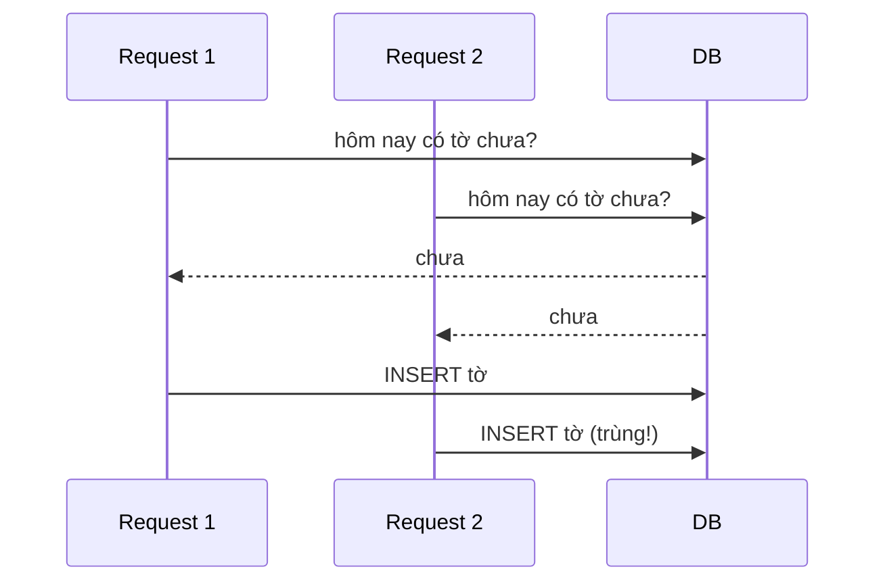
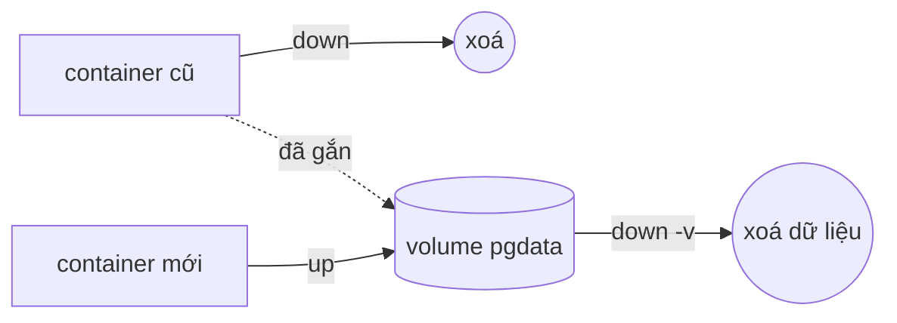
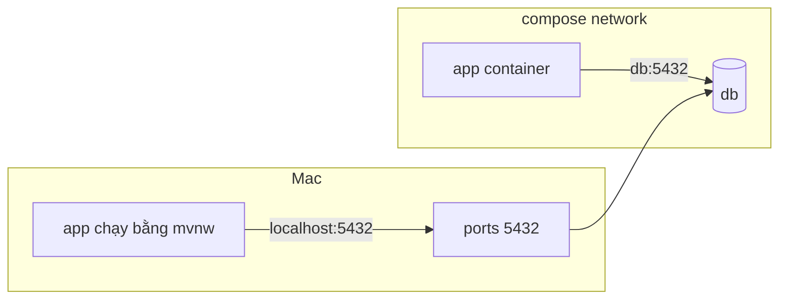
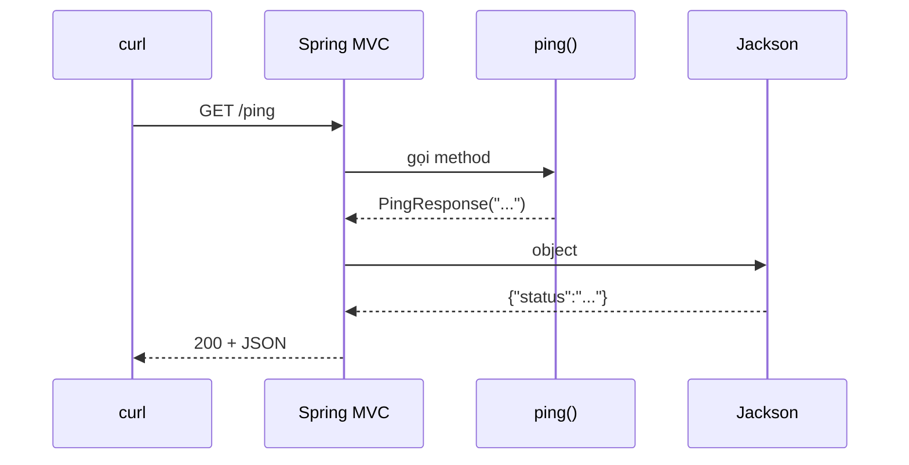

# Câu hỏi ôn tập

Tự trả lời trước, rồi mới mở đáp án.

## Ngày 0: Data model

### 1. Một tờ có nhiều thẻ, một thẻ nằm ở nhiều tờ. Cất quan hệ này ở đâu?

Đáp án chốt

Quan hệ **N-N** (many-to-many). Một ô trong Postgres chỉ chứa một giá trị, nên không nhét list vào TICKET hay TAG được. Phải có **bảng trung gian** (junction / mapping / association / bridge table), mỗi dòng là một cặp (tờ, thẻ):

| ticket_id | tag_id |
| --- | --- |
| A | cà phê |
| A | nghỉ |
| B | cà phê |

- Khoá chính là **cặp** `(ticket_id, tag_id)`, nên một cặp không xuất hiện hai lần.
- Cả hai cột đều là khoá ngoại (FK).
- Trong JPA: `@ManyToMany` + `@JoinTable` (học kỹ ở Ngày 8).

### 2. Một user có nhiều tờ. Cột nối nằm ở bảng nào, vì sao?

Đáp án chốt

Quan hệ **1-N**: một user nhiều tờ, một tờ thuộc đúng một user. Khoá ngoại nằm ở bên **"nhiều"**: TICKET có cột `user_id` (FK). USER không giữ gì về tờ, vì một ô không chứa được 30 tờ.

- Quy tắc nhớ: 1-N thì FK nằm bên N.
- Trong JPA: phía TICKET dùng `@ManyToOne`, phía TICKET là **owning side** (bên giữ khoá ngoại).

### 3. Cột ngày của tờ nên là `LocalDate` hay `LocalDateTime`? Giờ chi tiết thì lấy ở đâu?

Đáp án chốt

Dùng **hai cột, mỗi cột một việc**:

- `day`: `LocalDate` (Postgres: `date`). Trả lời câu "tờ này của ngày nào". Dùng cho unique và lọc theo khoảng ngày.
- `created_at`: `Instant` hoặc `OffsetDateTime` (Postgres: `timestamptz`). Trả lời câu "bấm lưu lúc mấy giờ". Dùng để ghi vết.

Nếu chỉ dùng `LocalDateTime` thì 8h sáng và 21h tối là hai giá trị khác nhau, database không biết chúng cùng một ngày. Còn dính múi giờ: 23h ở Việt Nam là 16h UTC, có khi lệch sang ngày khác.

### 4. Code đã kiểm "hôm nay có tờ chưa" rồi. Vì sao vẫn cần database chặn trùng?

Đáp án chốt

Vì **concurrent requests** gây ra **race condition** (kiểu lỗi "check-then-act"):

Cả hai cùng kiểm *trước khi* bên nào kịp lưu, nên cả hai đều thấy "chưa". Code kiểm bao kỹ cũng không chặn được khe hở đó.

Database chặn được vì nó kiểm và lưu trong **cùng một bước**: `UNIQUE (user_id, day)`. Request tới sau bị từ chối, Spring ném `DataIntegrityViolationException`, code bắt lỗi này rồi trả **409 Conflict**.

Ví dụ đời thường: hai người cùng nhìn thấy ghế trống rồi cùng ngồi xuống. Ghế có gắn tên (unique) thì người tới sau bị mời đứng lên.

### 5. Unique constraint và optimistic locking khác nhau chỗ nào? Mỗi cái chặn chuyện gì?

Đáp án chốt

| | Unique constraint | Optimistic locking |
| --- | --- | --- |
| Chặn chuyện gì | **TẠO** trùng: hai dòng có cùng giá trị ở các cột đã khai báo | **SỬA** đè nhau: hai người cùng sửa một dòng, người sau xoá mất thay đổi của người trước |
| Nằm ở đâu | Database (`UNIQUE (user_id, day)`) | Ứng dụng + một cột `version` |
| Cách chạy | Database từ chối `INSERT`/`UPDATE` vi phạm | Mỗi lần sửa thì `version` tăng 1. Lúc lưu, `version` không khớp với lúc đọc thì báo lỗi |
| Trong Spring | `DataIntegrityViolationException` → 409 | `@Version` trên Entity, lỗi `ObjectOptimisticLockingFailureException` → 409 |

Hai cái không thay thế nhau, Sổ Sói dùng cả hai.

Ví dụ đời thường của optimistic locking: hai người cùng mở một file Google Sheet bản cũ. Người lưu sau được báo "file đã đổi, tải lại rồi sửa tiếp", chứ không âm thầm đè lên.

### 6. Thẻ dùng chung hay mỗi người một bộ? Chọn cái nào, cần thêm cột gì, luật unique gì?

Đáp án chốt

**Mỗi người một bộ thẻ.** Dùng chung thì một người đổi tên hay xoá thẻ sẽ làm tờ của người khác bị đổi theo.

- TAG thêm cột `user_id` (FK tới USER). Đây là quan hệ 1-N: một user nhiều thẻ.
- Luật: `UNIQUE (user_id, name)`. Trong sổ của một người không có hai thẻ trùng tên, nhưng hai người khác nhau thì đều có `cà phê` được.
- "Phình ra" không đáng lo: 1.000 người × 30 thẻ = 30.000 dòng, với Postgres là nhỏ.
- `Cà phê` và `cà phê`: Postgres mặc định so sánh **phân biệt hoa thường**, nên coi là khác nhau. Muốn coi là trùng thì chuẩn hoá trước khi lưu (ví dụ chuyển hết về chữ thường), hoặc tạo unique index trên `lower(name)`. Để sau.

## Ngày 1: Khởi tạo

### 1. Gõ `docker compose down` rồi `up -d` lại, dữ liệu trong `mydb_sosoi` còn không? Còn `docker compose down -v` thì sao?

Docs: [Docker: Volumes](https://docs.docker.com/engine/storage/volumes/)

Đáp án

- `down`: xoá **container**, giữ **volume** `pgdata`. Bật lại, container mới gắn vào đúng volume cũ, dữ liệu còn nguyên.
- `down -v`: xoá luôn volume. Bật lại là database trắng.
- Dữ liệu sống trong volume, không sống trong container. Dòng `pgdata:/var/lib/postgresql/data` nối thư mục dữ liệu của Postgres trong container ra volume.

Ví dụ đời thường: container là cái bàn, volume là cuốn sổ. Đổi bàn mới thì sổ vẫn còn. `-v` là vứt luôn cuốn sổ.

### 2. App đang gọi database bằng `localhost:5432`. Ngày 14 app cũng chạy trong compose, URL đổi thành gì? Vì sao `localhost` không dùng được nữa?

Docs: [Compose: Networking](https://docs.docker.com/compose/how-tos/networking/)

Đáp án

- Bây giờ app chạy trên máy Mac, `localhost:5432` là cổng Mac, được nối vào container nhờ `ports`.
- Khi app nằm trong container riêng, `localhost` là **chính container app**, ở đó không có Postgres.
- Compose tự tạo một mạng chung, các service gọi nhau bằng **tên service**: `jdbc:postgresql://db:5432/mydb_sosoi`. Đi trong mạng nội bộ này thì không cần `ports` nữa.

Ví dụ đời thường: ở nhà mình, "phòng bếp" là bếp nhà mình. Qua nhà hàng xóm nói "phòng bếp" là bếp nhà họ. Muốn chỉ đúng thì gọi theo tên nhà.

### 3. `ping()` trả về một `record PingResponse`, client nhận được chuỗi JSON. Ai biến object thành JSON?

Docs: [Building a RESTful Web Service](https://spring.io/guides/gs/rest-service/)

Đáp án

- `@RestController` = `@Controller` + `@ResponseBody`: giá trị trả về của method được ghi thẳng vào **body** của response, không đi tìm trang HTML.
- Spring đưa object cho **Jackson** (thư viện có sẵn trong `spring-boot-starter-webmvc`). Jackson đọc các field của record (`status`) và viết ra `{"status":"..."}`, kèm header `Content-Type: application/json`.
- Tên field trong record chính là key trong JSON. Đổi `status` thành `state` là client nhận key khác.

Ví dụ đời thường: anh viết thư bằng tiếng Việt (object Java), bưu điện (Jackson) dịch sang mẫu chung (JSON) để người nhận ở nước nào cũng đọc được.

